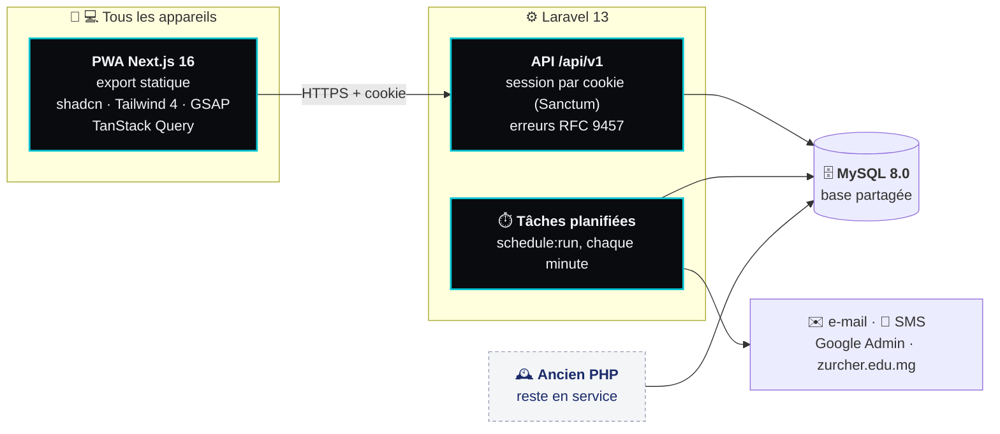

<div align="center">


# Registrar UAZ

**La nouvelle application de l'Université Adventiste Zurcher**<br>
Web · Android · iOS · Windows · macOS — une seule application (PWA), sur la **même base de données** que l'ancien PHP.


[Démarrer](#-démarrer-en-5-minutes) ·
[Architecture](#-architecture) ·
[Avancement](#-avancement) ·
[Qui voit quoi](#-qui-voit-quoi) ·
[Preuves](#-les-preuves) ·
[Documentation](#-documentation)

</div>

---

## 🧭 En bref

| | |
|---|---|
| **Quoi** | Refonte de `registrar.zurcher.edu.mg` : espace étudiant, enseignant, registrariat et finance. |
| **Comment** | Migration **« strangler »** : l'ancien PHP reste en service, page par page la nouvelle application prend le relais. |
| **Garde-fou** | Les migrations ne font qu'**ajouter** (jamais de table ni de colonne renommée ou supprimée) : l'ancien code lit toujours les mêmes données. |
| **Confiance** | Chaque écran est comparé aux **vraies fonctions de l'ancien code** sur une copie des données réelles : voir [les preuves](#-les-preuves). |
| **Langue** | Interface, messages d'erreur et documentation en français. |

---

## 🏗️ Architecture



| Dossier | Contenu |
|---|---|
| 🧩 [`api/`](api) | API **Laravel 13** (`/api/v1`) sur la base MySQL existante. Session par cookie (Sanctum SPA). |
| 🖥️ [`web/`](web) | Application **Next.js 16** en **export statique** (SPA/PWA) : shadcn/ui, Tailwind 4, GSAP, TanStack Query. |
| 📚 [`docs/`](docs) | Études 01 à 05, plan des pages, détail des écrans, schéma de production (structure seule), maquettes. |
| 🚀 [`deploy/`](deploy) | Exemples de configuration serveur (nginx, PHP-FPM, variables). **Non appliqués, non testés.** |
| 🛠️ [`tools/`](tools) | Outils (inventaire des routes de l'ancienne application). |

> **À lire d'abord** : [`docs/ETUDE-05-api-et-authentification.md`](docs/ETUDE-05-api-et-authentification.md).

---

## 🗺️ Avancement

Cinq lots sur huit sont terminés. Plan détaillé : [`docs/PLAN-PAGES.md`](docs/PLAN-PAGES.md) ; inventaire des 127 routes de l'ancienne application avec leur usage réel : [`docs/INVENTAIRE-PAGES.md`](docs/INVENTAIRE-PAGES.md) (régénérable : `python tools/inventaire.py`).

| Lot | Domaine | Avancement | État |
|---|---|---|---|
| **1** | Connexion, déconnexion, accueil étudiant | `██████████` | ✅ fait |
| **2** | **Espace étudiant** : notes, présence, inscriptions + fiche PDF, profil, actualités, quiz, jeu | `██████████` | ✅ fait |
| **3** | **Espace enseignant** : présence (hors ligne), remise de notes à colonnes libres | `█████████░` | 🟢 fait, reste le tableau de bord enseignant |
| **4** | **Registrariat** : validation des notes, assiduité, listes et fiches, tableau de bord, candidatures, création d'étudiant | `██████████` | ✅ fait |
| **5** | **Finance** : réinscription, soldes, échéances, barème et frais supplémentaires | `██████████` | ✅ fait |
| **6** | **Exports et impressions** : vrai PDF serveur pour les documents officiels, XLSX et CSV pour les listes | `████░░░░░░` | 🟡 en cours : fiche d'inscription, relevé semestriel et certificat de scolarité faits |
| **7** | Messagerie, inscriptions au guichet, file d'attente, emploi du temps, outils | `░░░░░░░░░░` | ⏳ à venir |
| **8** | Les 53 pages **jamais ouvertes** en deux mois | `░░░░░░░░░░` | 💤 restent sur l'ancien PHP |

<details>
<summary><b>Pas encore fait</b> (hors lots)</summary>

- repli enseignant et création de compte étudiant à la première connexion Google ;
- billet de pont vers l'ancien PHP (`legacy-login.php`) ;
- « se souvenir de moi » ;
- photo à la création d'un étudiant (à ajouter depuis l'ancienne version) ;
- les écrans des lots 6 à 8 : en attendant, l'ancienne version les sert.

</details>

---

## 👥 Qui voit quoi

| Profil | Ce qu'il ouvre dans la nouvelle application |
|---|---|
| 🎓 **Étudiant** (niveau 8) | Accueil · **Mes notes** · **Ma présence** · **Mes inscriptions** (fiche PDF) · **Mes informations** · Actualités · Quiz · Jeu |
| 🧑‍🏫 **Enseignant** (7), chef de mention (6), personnel qui enseigne | **Présence** (appel, **hors ligne**) · **Remise de notes** (colonnes libres) |
| 🗂️ **Registrariat** (niveaux 1 à 3) | Tableau de bord · **Validation des remises** (annulable 10 s) · Étudiants, cours, enseignants · Candidatures · Création d'étudiant · Assiduité (superadmin et registrariat) |
| 🖨️ **Documents** | **Fiche d'inscription** et **relevé semestriel** en PDF (niveaux 1 à 4) · **certificat de scolarité** (niveaux 1 à 3 et chef de mention, limité à sa mention), depuis la fiche d'un étudiant |
| 💰 **Finance** | **Réinscription** (niveaux 1, 3, 4) · **Soldes** (1 à 4) · **Échéances** (1 à 4) · **Barème** (1 à 3) |

Niveaux : 1 superadmin · 2 administration · 3 registrariat · 4 comptabilité · 5 media · 6 chef de mention · 7 enseignant · 8 étudiant · 9 Work Education. Les droits sont **revérifiés par le serveur à chaque appel** (403 avant toute validation) : masquer un bouton ne suffit jamais.

Détail, règles et écarts assumés de chaque écran : [`docs/FONCTIONNALITES.md`](docs/FONCTIONNALITES.md).

---

## 🚀 Démarrer en 5 minutes

```powershell
.\start-dev.ps1          # base réelle locale ; ouvre 3 fenêtres : API, relais, application
.\start-dev.ps1 -Demo    # base de démonstration (mot de passe commun : mot-de-passe-test)
# puis http://localhost:3000
```

Connexion par identifiant + mot de passe (Google n'est pas activé en local).

<details>
<summary><b>Lancement manuel</b></summary>

Dossier `api/`, PHP 8.3 explicite : `php artisan serve --host=127.0.0.1 --port=8001`. Puis dans `web/` : `node e2e/dev-proxy.mjs` et `NEXT_PUBLIC_API_URL=http://localhost:8000 npm run dev`.

</details>

### Prérequis (poste Windows / Laragon)

| Outil | Version | Remarque |
|---|---|---|
| PHP | **8.3** (`C:\laragon\bin\php\php-8.3.30-…`) | Pas celui du PATH (8.5, sans `pdo_mysql`). La production est en 8.3.6 : `composer.json` verrouille la plateforme. |
| Composer · Node | Node **24+** | |
| MySQL | celui de Laragon | La production est un serveur **MySQL 8.0.46** (et non MariaDB, erreur corrigée dans l'étude 01). |

### Trois bases locales

| Base | Contenu | Usage |
|---|---|---|
| 🟢 `registrar-crossplatform` | **Copie locale de la sauvegarde réelle** (stockée hors du dépôt, importée le 14/11/2026) | Développement : se connecter avec ses vrais identifiants |
| 🟡 `registrar-crossplatform_demo` | Structure + comptes **fictifs** | Test de bout en bout (`.\start-dev.ps1 -Demo`) |
| 🔵 `registrar-crossplatform_test` | Structure seule, vide | Tests PHP (annulés à la fin de chaque test) |

> [!CAUTION]
> - La sauvegarde reste sur `G:` : **elle n'est jamais copiée dans le dépôt** (`.gitignore` écarte aussi `registrar_db.sql`). Les vraies données d'étudiants ne sortent pas de ce poste.
> - **Ne jamais lancer `DemoSeeder` sur la base réelle** (il ajouterait de faux comptes dans votre copie).
> - Les tests PHP refusent de tourner sur une base dont le nom ne finit pas par `_test`.
> - Les serveurs de développement n'écoutent que sur le **bouclage local** (127.0.0.1 / ::1) : la copie des vraies données ne doit jamais être joignable depuis le réseau. Ne pas les relancer avec `--host=0.0.0.0` ni `next dev -H 0.0.0.0`.

---

## ✅ Tests

| Suite | Nombre | Ce qu'elle couvre |
|---|---|---|
| 🐘 **PHP** (`api/`) | **1 035** | connexion, Google (vraie cryptographie), notes, assiduité, certificats et autres PDF, quiz, registrariat, finance, erreurs |
| ⚛️ **Web** (`web/`) | **361** | client d'API (CSRF, réessai sur 419, hors réseau), formats, calculs, reprise après échec de chargement |
| 🌐 **e2e Chrome** | **552** vérifications (551 au dernier passage complet : un préchargement de page coupé par le réseau local de Windows) | parcours réels dans un vrai navigateur, dont le téléchargement d'un vrai PDF, la connexion par la fiche, les Actualités et la résolution réelle du Rubik's Cube. Base **de démonstration** uniquement. |

```bash
cd api && php artisan test
cd web && npm test
cd web && npm run lint && npx tsc --noEmit
```

<details>
<summary><b>Lancer le test de bout en bout (e2e)</b></summary>

```bash
.\start-dev.ps1 -Demo                 # puis, dans web/ : npm run build (avec NEXT_PUBLIC_API_URL=http://localhost:8000)
cd web && python -m http.server 3000 -d out   # (à la place de « npm run dev »)
cd api && php artisan db:seed --class=DemoSeeder   # AVANT chaque passage : remet à zéro le joueur de démonstration du quiz (base _demo seulement)
cd api && php artisan cache:clear     # remet à zéro la limitation de débit (10 essais / 15 min / identifiant)
cd web && npm run e2e
```

Pour l'e2e, l'API de démonstration se lance **directement** : depuis `api/public`, `DB_DATABASE=registrar-crossplatform_demo STUDENT_PHOTOS_PATH=…/storage/app/demo-photos ANNOUNCEMENT_IMAGES_PATH=…/storage/app/demo-announcements php -S 127.0.0.1:8001 -t . ../vendor/laravel/framework/src/Illuminate/Foundation/resources/server.php` (`artisan serve` ne transmet pas `DB_DATABASE` : l'API lirait la base réelle). Le site statique doit écouter en IPv4 ET IPv6 (`python -m http.server 3000 --bind 127.0.0.1` en plus de `--bind ::1`). Passer `DB_DATABASE=registrar-crossplatform_demo` et `PHP_BIN` (PHP 8.3) à `node e2e/smoke.mjs` : les commandes planifiées du test s'exécutent sur cette base. Le script rejoue les `fetch` qui n'atteignent pas le serveur (refus réseau local de Windows) mais pas les réponses HTTP.

</details>

---

## 🔬 Les preuves

Pour chaque écran repris, la **vraie fonction de l'ancien code** est exécutée sur les données réelles locales (en lecture ; en écriture, sur une copie jetable) et comparée champ par champ à la nouvelle. Une mutation volontaire du code vérifie ensuite que les tests la détectent.

| Écran | Ce qui a été comparé | Écarts |
|---|---|:---:|
| 🎓 Mes notes | **180** comptes étudiants actifs | **0** |
| 🎓 Ma présence | **76** étudiants, **94** registres + 500 scénarios aléatoires | **0** |
| 🎓 Fiche d'inscription | **482** inscriptions visibles (cours, crédits, tranches, total) | **0** |
| 🧑‍🏫 Présence enseignant | 12 registres, **94** bilans, 329 listes de cours | **0** |
| 🧑‍🏫 Remise de notes | **31** remises (380 lignes) + **20 000** cas aléatoires | **0** |
| 🛡️ Validation des remises | **300** scénarios, 403 notes écrites | **0** |
| ⏰ Assiduité (registrariat) | **94** signalements × 2 années, avec et sans traités | **0** |
| 📋 Listes et fiches | **420** états aléatoires, **24 667** lignes | **0** |
| 📬 Candidatures | **77** candidatures : 231 courriels et 231 SMS | **0** |
| ➕ Création d'étudiant | matricules (156 cas), **814** vérifications d'adresse | **0** |
| 🔓 Réinscription | **902** vérifications | **0** |
| ⚖️ Soldes | 15 sessions, 2 249 lignes, **50** saisies rejouées | **0** |
| 📅 Échéances | **1 683** vérifications, 400 saisies aléatoires | **0** |
| 🏷️ Barème et frais | **47 088** cases + **12 674** vérifications d'écriture | **0** |
| 🖨️ Fiche d'inscription (personnel) | **2 295** fiches, toutes années (la vraie fiche ancienne) | **0** (hors ligne costume, assumé) |
| 📑 Relevé semestriel | **2 724** relevés, **72 976** lignes de cours (la vraie page ancienne) | **0** (hors écarts déclarés) |

Les écarts **voulus** (corrections par rapport à l'ancien comportement) sont listés écran par écran dans [`docs/FONCTIONNALITES.md`](docs/FONCTIONNALITES.md).

---

## 🛡️ Règles à ne pas casser

> [!IMPORTANT]
> - **Une note n'est visible d'un étudiant que si sa session est publiée** (`t_notes_publication.publiee = 1`) : la règle vit dans la requête (`api/app/Domain/Student/StudentHome.php`), jamais dans l'écran. La moyenne n'inclut jamais une session masquée.
> - **Aucune migration destructrice** : on ne renomme ni ne supprime de table ou de colonne tant que l'ancien PHP tourne (Moodle lit des vues `v_moodle_*`). Les nouvelles migrations ne font qu'ajouter.
> - **Un seul journal** : les connexions s'écrivent dans `security_logs`, comme l'ancienne application, avec le motif d'échec. Jamais de mot de passe ni d'identifiant saisi inconnu dans le journal.
> - Les erreurs de l'API sont en `application/problem+json` avec un `code` stable ; le front décide d'après le code, jamais d'après le texte.

---

## 🪟 Windows : deux pièges rencontrés

> [!WARNING]
> 1. **`127.0.0.1` refusé par intermittence** (erreur 10013 / `ERR_NETWORK_ACCESS_DENIED`) pour PHP et Chrome, pas pour Node ni le client MySQL. Cause non identifiée (filtre réseau du poste). Contournements : base en `DB_HOST=localhost`, serveurs de test en double pile IPv4/IPv6, et le test navigateur relance une page *uniquement* sur cette erreur précise et l'indique.
> 2. **`php artisan serve` ne traite qu'une connexion à la fois** : les connexions « spéculatives » de Chrome le bloquent. D'où le relais `web/e2e/dev-proxy.mjs`. Sans objet en production (nginx + PHP-FPM).

<details>
<summary><b>Nouveautés de versions (14/11/2026)</b></summary>

Laravel est en **13.x** (pas 12), Next.js en **16.4**, shadcn utilise le style `base-nova` (Base UI) et le paquet `cn` de shadcn. Le `AGENTS.md` généré par Next.js demande de lire `node_modules/next/dist/docs/` avant de coder : c'est fait pour l'export statique. Le squelette Laravel proposait en outre d'installer « Laravel Boost » et des installeurs `curl | bash` : **non installés**, fichiers supprimés.

</details>

---

## 🎨 Direction visuelle « Affiche »

Un seul accent de couleur sur des fonds neutres. Référence complète : [`docs/ETUDE-03-direction-visuelle.md`](docs/ETUDE-03-direction-visuelle.md), valeurs dans `web/src/app/globals.css`.

| Rôle | Sombre | Clair |
|---|---|---|
| Accent (actions, traits) |  `#00c4d4` |  `#00727e` (texte, 5,2:1) |
| Fond |  `#0a0b0f` |  `#f4f5f7` |
| Carte |  `#10131a` |  `#ffffff` |
| Bouton principal (clair) | |  `#1a2b6a` (marine) |

Tous les contrastes texte/fond sont ≥ 4,5:1.

---

## 📚 Documentation

| Document | Pour quoi faire |
|---|---|
| 🧱 [`docs/FONCTIONNALITES.md`](docs/FONCTIONNALITES.md) | **Le détail de chaque écran** : règles reprises, écarts assumés, preuves, tests. À compléter à chaque tranche livrée. |
| 🗺️ [`docs/PLAN-PAGES.md`](docs/PLAN-PAGES.md) | Les huit lots, dans l'ordre de l'usage réel. |
| 📇 [`docs/INVENTAIRE-PAGES.md`](docs/INVENTAIRE-PAGES.md) | Les 127 routes de l'ancienne application et leur usage réel. |
| 🔍 [`docs/ETUDE-01-existant-et-stack.md`](docs/ETUDE-01-existant-et-stack.md) | L'existant et le choix de la pile. |
| 📊 [`docs/ETUDE-02-decisions-et-usage-reel.md`](docs/ETUDE-02-decisions-et-usage-reel.md) | Décisions et usage réel. |
| 🎨 [`docs/ETUDE-03-direction-visuelle.md`](docs/ETUDE-03-direction-visuelle.md) | Direction visuelle « Affiche ». |
| ✨ [`docs/ETUDE-04-ameliorations-fonctionnelles.md`](docs/ETUDE-04-ameliorations-fonctionnelles.md) | Améliorations fonctionnelles. |
| 🔐 [`docs/ETUDE-05-api-et-authentification.md`](docs/ETUDE-05-api-et-authentification.md) | **API, authentification, hors ligne, « annuler » côté serveur.** À lire d'abord. |
| 🖼️ [`docs/maquettes/`](docs/maquettes) | Maquettes HTML (direction visuelle, structure v2). |
| 🚀 [`deploy/README.md`](deploy/README.md) | Mise en ligne : variables, migrations, tâches planifiées, notes par lot. |

---

<div align="center">

Fait pour le registrariat, les enseignants et les étudiants de l'UAZ.<br>
<sub>L'ancienne application reste la référence tant qu'un écran n'a pas sa preuve de parité.</sub>

</div>
